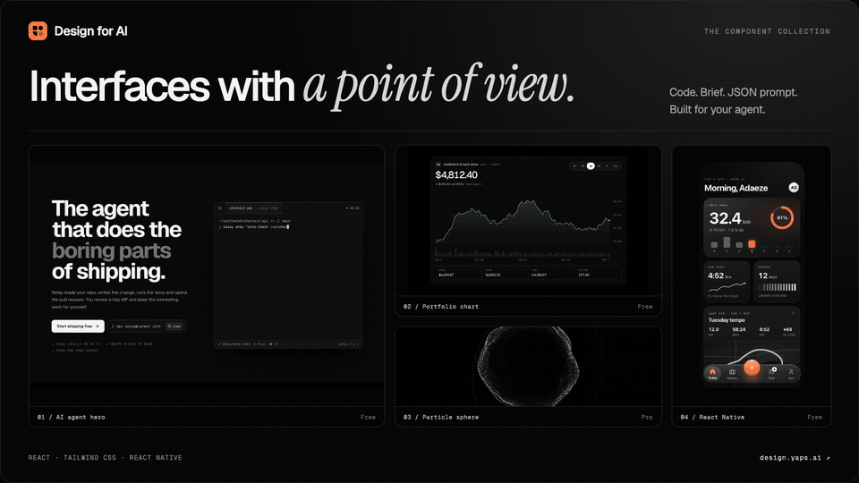
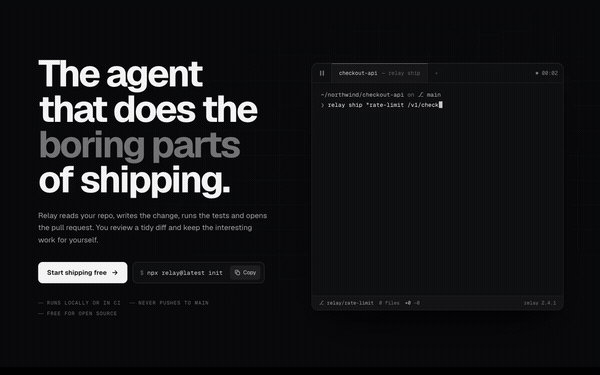
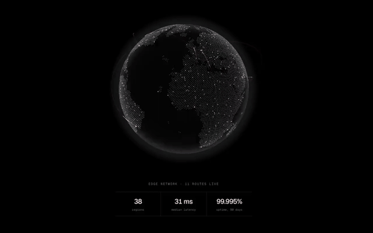
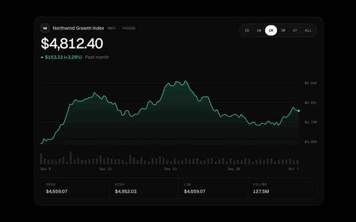
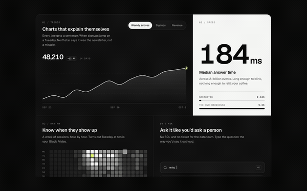
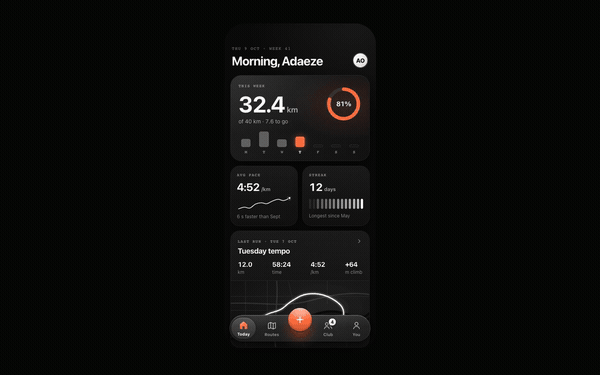
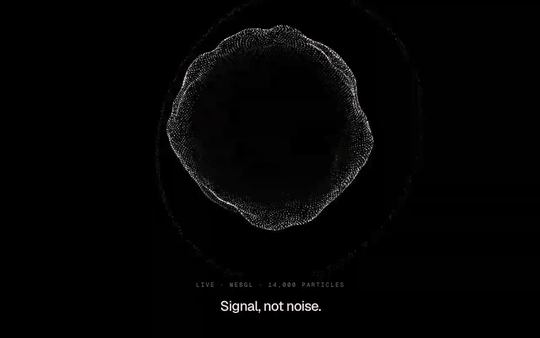

<div align="center">

<picture>
  <source media="(prefers-color-scheme: dark)" srcset=".github/assets/wordmark-dark.png">
  
</picture>

# React components for AI coding agents

**Bring taste to what your agent ships.**

Animated React, Tailwind CSS and React Native components for Claude Code, Cursor, Codex and other AI coding agents. Every component comes with source code, a design brief and a JSON prompt.

[Explore components](https://design.yaps.ai/components) · [Documentation](https://design.yaps.ai/docs) · [Connect your agent](https://design.yaps.ai/docs/agents) · [Design principles](https://design.yaps.ai/docs/principles) · [Pricing](https://design.yaps.ai/pricing)

<a href="https://design.yaps.ai/components">
  <picture>
    <source media="(prefers-reduced-motion: reduce)" srcset=".github/assets/showcase-still.png">
    
  </picture>
</a>

</div>

## Why Design for AI?

- **A designed starting point.** Give your agent a specific component instead of asking it to invent a design system from a blank prompt.
- **Three ways to build.** Install the React or React Native source, paste the design brief, or pass the JSON prompt to your agent. Each describes the same interface.
- **Motion with a purpose.** Chart ranges morph, replies stream, navigation moves on springs, and loading resolves into a result. Preview the behaviour before using it.
- **Your code, your stack.** Free components are MIT. Components live in your project, with typed props and explicit dependencies. Pro source is licensed separately.

## See the components in motion

These are recordings of the actual components. Open any preview to try its controls, see the code or copy its brief. Readers with reduced motion enabled see still images.

<table>
  <tr>
    <td width="50%" valign="top">
      <a href="https://design.yaps.ai/components/hero-terminal-agent">
        <picture>
          <source media="(prefers-reduced-motion: reduce)" srcset=".github/assets/hero-terminal-agent.png">
          
        </picture>
      </a>
      <p><strong>AI agent hero</strong><br>A live terminal session, ordered reveals and a copyable install command.<br><a href="https://design.yaps.ai/components/hero-terminal-agent">Try the component</a> · Free</p>
    </td>
    <td width="50%" valign="top">
      <a href="https://design.yaps.ai/components/three-globe-arcs">
        <picture>
          <source media="(prefers-reduced-motion: reduce)" srcset=".github/assets/three-globe-arcs.png">
          
        </picture>
      </a>
      <p><strong>WebGL globe</strong><br>A rotating point globe with flight arcs and a quiet, precise readout.<br><a href="https://design.yaps.ai/components/three-globe-arcs">Try the component</a> · Pro</p>
    </td>
  </tr>
  <tr>
    <td width="50%" valign="top">
      <a href="https://design.yaps.ai/components/chart-portfolio">
        <picture>
          <source media="(prefers-reduced-motion: reduce)" srcset=".github/assets/chart-portfolio.png">
          
        </picture>
      </a>
      <p><strong>Portfolio chart</strong><br>A hand-drawn SVG chart with range morphs, volume and a crosshair.<br><a href="https://design.yaps.ai/components/chart-portfolio">Try the component</a> · Free</p>
    </td>
    <td width="50%" valign="top">
      <a href="https://design.yaps.ai/components/bento-grid">
        <picture>
          <source media="(prefers-reduced-motion: reduce)" srcset=".github/assets/bento-grid.png">
          
        </picture>
      </a>
      <p><strong>Live analytics bento</strong><br>Drawing charts, counting figures and six tiles that tell one story.<br><a href="https://design.yaps.ai/components/bento-grid">Try the component</a> · Free</p>
    </td>
  </tr>
  <tr>
    <td width="50%" valign="top">
      <a href="https://design.yaps.ai/components/mobile-tab-bar">
        <picture>
          <source media="(prefers-reduced-motion: reduce)" srcset=".github/assets/mobile-tab-bar.png">
          
        </picture>
      </a>
      <p><strong>React Native navigation</strong><br>Glass, morphing icons and a spring-driven lens, with an arc menu.<br><a href="https://design.yaps.ai/components/mobile-tab-bar">Try the component</a> · Free</p>
    </td>
    <td width="50%" valign="top">
      <a href="https://design.yaps.ai/components/three-particle-sphere">
        <picture>
          <source media="(prefers-reduced-motion: reduce)" srcset=".github/assets/three-particle-sphere.png">
          
        </picture>
      </a>
      <p><strong>Particle sphere</strong><br>A living point cloud with depth, rhythm and a restrained silver palette.<br><a href="https://design.yaps.ai/components/three-particle-sphere">Try the component</a> · Pro</p>
    </td>
  </tr>
</table>

[Browse the full component library →](https://design.yaps.ai/components)

## What you get with every component

| Format | What it contains | When to use it |
| --- | --- | --- |
| **Source code** | A self-contained `.tsx` file with typed props. React + Tailwind CSS, or React Native with declared dependencies. | Install it in your project and adapt it. |
| **Design brief** | Type, spacing, colour, motion, responsive behaviour, accessibility and the choices to avoid. | Ask your agent to rebuild it in your brand or stack. |
| **JSON prompt** | The same brief as structured data with a consistent schema. | Automate generation or change one design decision at a time. |

## Explore by category

| Build | Start here |
| --- | --- |
| AI chat, streaming answers and agent workflows | [AI interfaces](https://design.yaps.ai/categories/ai) · [Agent components](https://design.yaps.ai/categories/agents) |
| Landing pages and product marketing | [Heroes](https://design.yaps.ai/categories/hero) · [Features](https://design.yaps.ai/categories/features) · [Pricing](https://design.yaps.ai/categories/pricing) |
| Dashboards and analytics | [Charts](https://design.yaps.ai/categories/charts) · [App UI](https://design.yaps.ai/categories/app) |
| Generative visuals and WebGL | [3D components](https://design.yaps.ai/categories/three-d) · [Pixel components](https://design.yaps.ai/categories/pixel) |
| Mobile apps | [React Native components](https://design.yaps.ai/categories/mobile) |
| Product UI and forms | [Inputs](https://design.yaps.ai/categories/inputs) · [Authentication](https://design.yaps.ai/categories/auth) · [Feedback](https://design.yaps.ai/categories/feedback) |

## Quick start

### shadcn CLI

```bash
npx shadcn@latest add https://design.yaps.ai/r/chart-portfolio.json
```

### MCP server (Claude Code, Cursor, Windsurf, VS Code)

The site is a remote MCP server; nothing to install:

```bash
claude mcp add --transport http design-for-ai https://design.yaps.ai/mcp
```

Then ask: *"Find a Design for AI chart component and add it to the dashboard."* Prefer a local process? `npx -y https://design.yaps.ai/mcp.tgz`.

### CLI

```bash
npx https://design.yaps.ai/cli.tgz search sign in
npx https://design.yaps.ai/cli.tgz add auth-sign-in      # writes the file, installs its dependencies
npx https://design.yaps.ai/cli.tgz prompt auth-sign-in   # the design brief, for your agent
```

### Claude skill

Copy [`skills/design-for-ai`](skills/design-for-ai) into `.claude/skills/` (one project) or `~/.claude/skills/` (every project). It teaches your agent when to reach for a component, how to adapt one without flattening it, and the checklist to run before it says it's done.

### Paste the brief

Open any component page, hit **Copy for agent**, and paste it into your chat. You get the install command, the design brief and the source in one message.

### For language models

- Every page has a Markdown twin: add `.md` to any URL ([`/index.md`](https://design.yaps.ai/index.md), [`/pricing.md`](https://design.yaps.ai/pricing.md))
- [`/llms.txt`](https://design.yaps.ai/llms.txt): a map of the library
- [`/llms-full.txt`](https://design.yaps.ai/llms-full.txt): every free component's prompt and JSON prompt
- [`/api/registry`](https://design.yaps.ai/api/registry): a JSON index of everything

## Repository layout

```
app/                    Next.js site (App Router): gallery, docs, blog, API, SEO routes
components/site/        Site chrome, never shipped to users
registry/free/<slug>/   Free components: <slug>.tsx, meta.json, prompt.md, prompt.json (MIT)
registry/pro/           Pro components, cloned from a private repo at build time (gitignored)
registry/pro-manifest.json   Public metadata for Pro components
content/                Public documentation (Markdown)
registry/pro/_site/     Private blog source and localization dictionaries
scripts/                Registry build, screenshots, Pro sync
packages/mcp/           design-for-ai-mcp, the local (stdio) MCP server
packages/cli/           design-for-ai, the CLI
lib/mcp.ts, app/mcp/    the remote MCP server at /mcp
skills/design-for-ai/   Claude skill: find, adapt and review against the principles
docs/COMPONENT_SPEC.md  The bar every component is held to
```

## Develop

```bash
npm install
npm run dev                                   # http://localhost:3000
node scripts/build-registry.mjs               # validate every component
node scripts/shot.mjs <slug> --base=http://localhost:3000   # screenshots at 1440/768/390
```

Production runs on Cloudflare Workers (`design-yaps`, on `design.yaps.ai`) via OpenNext; see [`docs/DEPLOY.md`](docs/DEPLOY.md). `npm run preview` runs the built Worker locally.

The site builds without the Pro source: Pro components render as locked cards using `registry/pro-manifest.json`. With access to the private repo, `npm run pro:sync` (needs `PRO_REPO_TOKEN`) clones it into `registry/pro/`.

## Contributing

New free components are welcome, and the bar is high on purpose. Read [`docs/COMPONENT_SPEC.md`](docs/COMPONENT_SPEC.md), build your component in `registry/free/<slug>/`, run the screenshot loop until it holds up at every width, and open a PR.

## Licence

Free components, the site and the tooling are [MIT](LICENSE). Pro components are licensed separately; see [design.yaps.ai/docs/license](https://design.yaps.ai/docs/license).

<sub>Design for AI is a [Yaps](https://www.yaps.ai) project.</sub>
